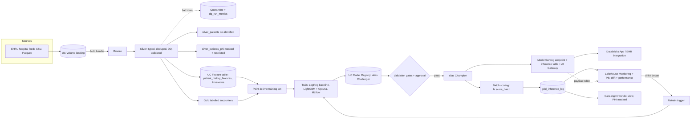

# Databricks ML POC: 30-Day Hospital Readmission Risk (1M encounters, end to end)

**Business problem.** Hospitals are penalised for avoidable readmissions. At discharge we score every patient's
probability of coming back within 30 days so care managers can prioritise follow-up calls and home-health visits for the
top ~10% highest-risk patients (their capacity).

**Scale.** 1,000,000 synthetic encounters (+~3M lab rows, 300k patients, fake PHI). Everything is synthetic, so you can run it with no data-sharing approval.

> **Honest status.** The shared library and unit tests were executed (9/9 pass, including the Spark tests for
> point-in-time features and DQ quarantine) and every file is syntax-checked. The notebooks target a live Databricks
> workspace and were **not run end-to-end here**. Databricks SDK / Feature Engineering / Online-store / Lakehouse-Monitoring
> APIs change between releases, so expect to adjust a few calls on first run. Spots most likely to need tweaks are
> flagged in the code with "verify" comments (online store, `quality_monitors`, runtime version, node type).

---

## 1. Architecture



## 2. Topic coverage matrix (nothing skipped)

| # | Topic | Where |
|---|---|---|
| 1 | Business framing, success metric, capacity-based threshold | this README, `05` |
| 2 | Environment / compute sizing, cost | §6 below |
| 3 | Unity Catalog setup (catalog, schema, volumes) | `00_setup_governance` |
| 4 | RBAC / least privilege grants | `00_setup_governance` §2 |
| 5 | PHI governance: column masks, row filters, tags, de-identification | `00_setup_governance`, `02` §3 |
| 6 | Audit logs & lineage (system tables) | `00_setup_governance` §4 |
| 7 | HIPAA / compliance controls (BAA, CMK, private link) | `00_setup_governance` §5 |
| 8 | Synthetic 1M-row data with injected dirt | `01`, `src/poc_lib/synth.py` |
| 9 | Ingestion: Auto Loader, schema evolution, idempotency | `02` §1 |
| 10 | Medallion architecture (bronze, silver, gold) | `02` |
| 11 | Data quality rules, quarantine, DQ metrics, gate | `02`, `src/poc_lib/dq.py` |
| 12 | Declarative pipelines / expectations (Lakeflow, ex-DLT) | `pipelines/lakeflow_encounters_pipeline.py` |
| 13 | Delta optimisation: liquid clustering, OPTIMIZE, ANALYZE, CDF | `02` §2, §5 |
| 14 | EDA, profiling, target analysis, bias baseline | `03` |
| 15 | Leakage prevention: matured labels, PIT windows, leakage tests | `02` §4, `04` §2 |
| 16 | Feature engineering: encounter, windowed history, labs, flags | `04`, `src/poc_lib/features.py` |
| 17 | Feature Store: UC timeseries feature table, merge refresh | `04` §3 |
| 18 | On-demand features (UC Python UDF), no train/serve skew | `04` §4 |
| 19 | Feature validation & selection (correlation, mutual information) | `04` §6-7 |
| 20 | Online feature store (optional, flagged) | `04` §8, `08` §8 |
| 21 | Temporal split, imbalance handling, metrics choice | `05` §1, `03` §7 |
| 22 | Baseline model, benchmark discipline | `05` §2 |
| 23 | Model training (LightGBM) + HPO (Optuna) with nested MLflow runs | `05` §3 |
| 24 | Experiment tracking, data versioning (Delta version logged), tags | `05` |
| 25 | Calibration, ROC/PR, lift, precision@k | `05`, `src/poc_lib/metrics.py` |
| 26 | Explainability (SHAP) | `05` |
| 27 | Fairness audit (Fairlearn) | `05`, `06` §2 |
| 28 | AutoML benchmark (optional) | `05` §5 |
| 29 | Model Registry (UC), aliases, descriptions, tags | `05` §4 |
| 30 | Validation gates, champion/challenger, approval, rollback | `06` |
| 31 | Batch inference with PIT feature lookup | `07` |
| 32 | Business consumption: worklist view, masked PHI, grants | `07` §3 |
| 33 | Real-time serving, scaling, AI Gateway rate limits, permissions | `08` |
| 34 | Inference tables / request-response logging | `08` §2, §7 |
| 35 | Load testing & SLOs | `08` §5 |
| 36 | A/B testing and rollback | `08` §6 |
| 37 | Client application (Databricks App) | `app/` |
| 38 | Monitoring: data quality, feature/prediction drift (PSI), performance with delayed labels | `09` |
| 39 | Lakehouse Monitoring (InferenceLog) | `09` §3 |
| 40 | Alerts, cost monitoring | `09` §4 |
| 41 | Automated retraining policy with cool-down | `10` |
| 42 | Orchestration: Workflows, DAG, conditional gate, schedule, file-arrival trigger | `databricks.yml` |
| 43 | IaC / environments (dev, staging, prod) via Asset Bundles | `databricks.yml` |
| 44 | CI/CD, tests, approvals, service principals | `.github/workflows/ci_cd.yml`, `tests/` |
| 45 | Documentation / model card essentials | §7 |

## 3. Repo layout

```
databricks.yml                 # Asset Bundle: 3 jobs, 3 environments
notebooks/
  00_config.py                 # shared config via %run, widgets = job params
  00_setup_governance.py       # UC, grants, masks, row filter, audit queries
  01_generate_synthetic_data.py
  02_bronze_silver_gold.py     # Auto Loader, DQ, PHI split, gold
  03_eda.py
  04_feature_engineering.py    # feature table, UDF, leakage tests, selection
  05_train_and_register.py     # baseline, HPO, SHAP, fairness, UC registration
  06_validate_and_promote.py   # gates, champion/challenger, baseline publish
  07_batch_scoring.py          # fe.score_batch, inference log, worklist
  08_deploy_realtime_endpoint.py
  09_monitoring.py             # drift, performance, Lakehouse Monitoring, drift simulation
  10_retrain_trigger.py
pipelines/lakeflow_encounters_pipeline.py
src/poc_lib/                   # synth, dq, features, metrics, scoring (unit-tested)
tests/                         # pytest (pure-python + local Spark)
app/                           # Streamlit Databricks App
.github/workflows/ci_cd.yml
```

## 4. How to run

**Option 1: interactive (fastest to understand).**
1. Import the repo as a Git folder in Databricks. Use a cluster on a recent **Databricks Runtime ML** (CPU), single user, 4+ workers and a driver with ≥32 GB RAM (notebook 05 pulls the training set to pandas).
2. Run in order: `00_setup_governance` → `01` → `02` → `03` → `04` → `05` → `06` → `07` → `08` → `09` → `10`.
3. In `06`, first run has no Champion so the challenger is promoted if gates pass. In `ENV=prod` set widget `approved=true`.
4. Demo drift: run `09` with `simulate_drift=true`, then re-check the PSI table and the retrain decision.

**Option 2: automated (bundle).**
```bash
databricks bundle validate -t dev
databricks bundle deploy   -t dev
databricks bundle run setup_data -t dev
databricks bundle run readmission_training_pipeline -t dev
databricks bundle run readmission_scoring_pipeline  -t dev
```
Dev uses 100k rows for cheap iteration; staging/prod use 1M.

**Local unit tests:** `pip install -r requirements-dev.txt && pytest -q`.

## 5. Design decisions worth defending in a review

* **Temporal split, not random.** Patients have many encounters; a random split leaks patient identity into test and inflates metrics.
* **Point-in-time features.** History windows exclude the current encounter and are verified by an independent self-join test (fails the pipeline on leakage).
* **Matured labels only.** Labels arrive 30 days after discharge; training uses only encounters whose window closed.
* **AUPRC and precision@top-10%, not accuracy.** ~15% prevalence and a fixed outreach capacity define the real objective. The threshold is the 90th percentile of validation scores.
* **Race excluded from features, audited in fairness checks.** Gender, insurance and age bands are gated on TPR gap ≤ 0.10. Always have clinical and ethics review of the thresholds.
* **Two registered artifacts, one training run.** `readmission_model` (feature-lookup packaged → batch) and `readmission_model_payload` (self-contained → real-time). Promotion moves both aliases together.
* **No auto-deploy.** Retraining creates a *Challenger*; gates + (in prod) human approval promote it. `Previous` alias gives instant rollback.
* **Decision support, not diagnosis.** The registry description and app banner say so.

## 6. Sizing and cost (rough guide, validate in your workspace)

| Stage | Compute | Notes |
|---|---|---|
| Ingest / silver / features | 4 workers, standard, Photon optional | minutes for 1M rows |
| Training | single big driver (32-64 GB) | Optuna 20 trials ≈ 10-30 min; raise `N_TRIALS` for production |
| Serving | Small workload, scale-to-zero in dev, min concurrency > 0 in prod | scale-to-zero cold starts break latency SLOs |
| Cost hygiene | job clusters (auto-terminate), serverless where available, tag clusters/jobs by `env`/`project`, query `system.billing.usage` | |

## 7. Model card checklist (fill in before real use)

Intended use and users · out-of-scope uses · training data window and population · features (no PHI, no race) · metrics on
temporal test (AUROC, AUPRC, precision@10%, lift, calibration) · fairness results by group · known limitations (synthetic
label here; real label = next-admission derived) · monitoring plan and owners · retraining policy · rollback procedure ·
approvals (clinical lead, privacy officer, ML lead).

## 8. Moving from POC to production with real data

1. Replace `01` with real feeds (HL7/FHIR/claims → landing volume or Lakeflow Connect); derive the label as `lead(admit_ts)` per patient within 30 days of discharge (and exclude deaths / planned readmissions per CMS definition).
2. Enable the **Compliance Security Profile**, CMK, private networking; sign a BAA. Run under service principals only.
3. Replace the stubbed row filter with an entitlement-table lookup; classify columns via tags and drive masks from them (ABAC).
4. Make silver incremental (CDF/streaming or Lakeflow pipelines) instead of full overwrite.
5. Increase HPO trials, add calibration (isotonic) if `pos_weight` > 1 is used, add clinical-rule baselines (e.g. LACE index) to compare against.
6. Add shadow-mode period, then A/B or phased rollout, and a clinical safety review before any workflow change.
7. Optional extensions: online feature store for lookup-based serving, streaming ingestion (Kafka/Event Hubs), GenAI discharge-summary features (with PHI controls), Vector Search for similar-patient retrieval.
